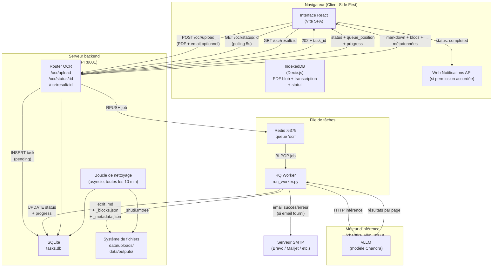
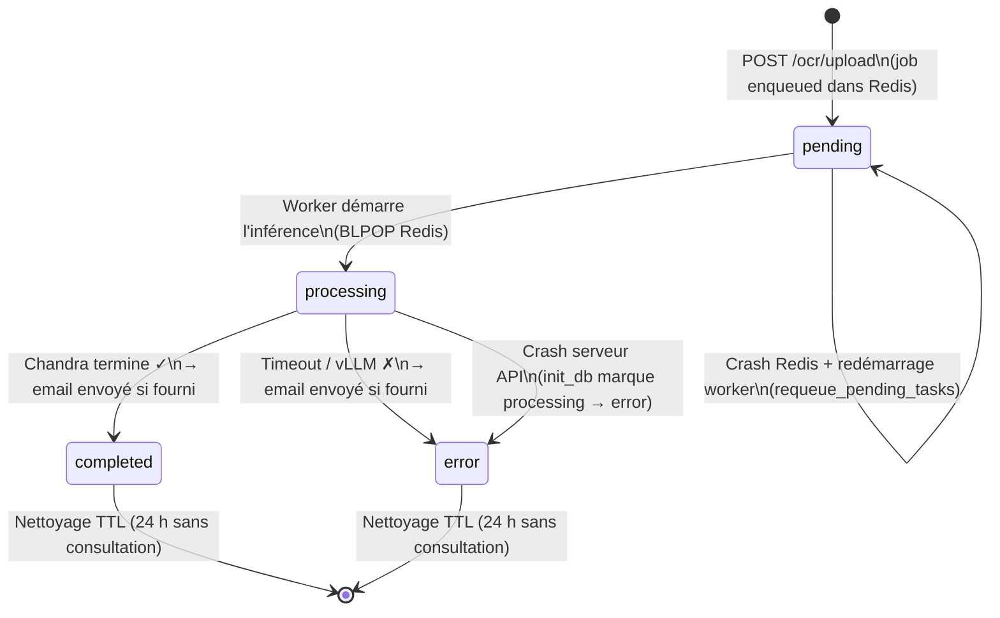
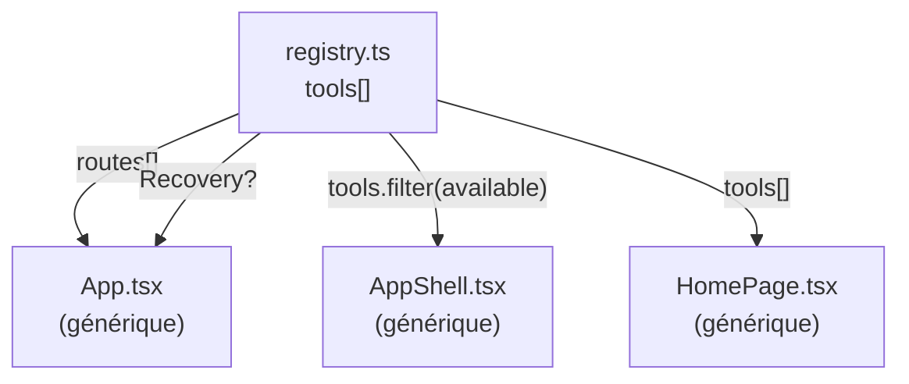
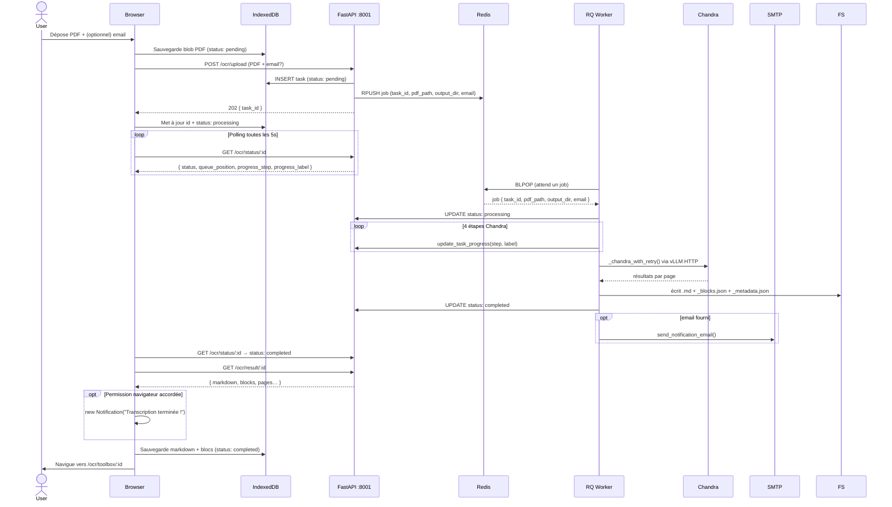
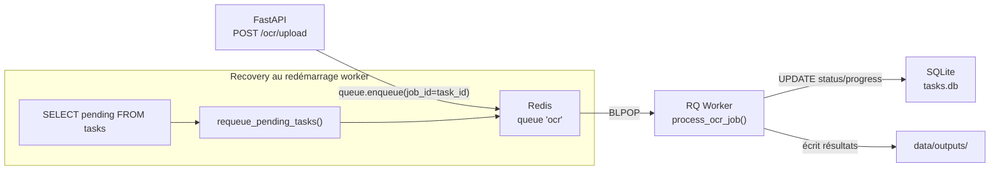
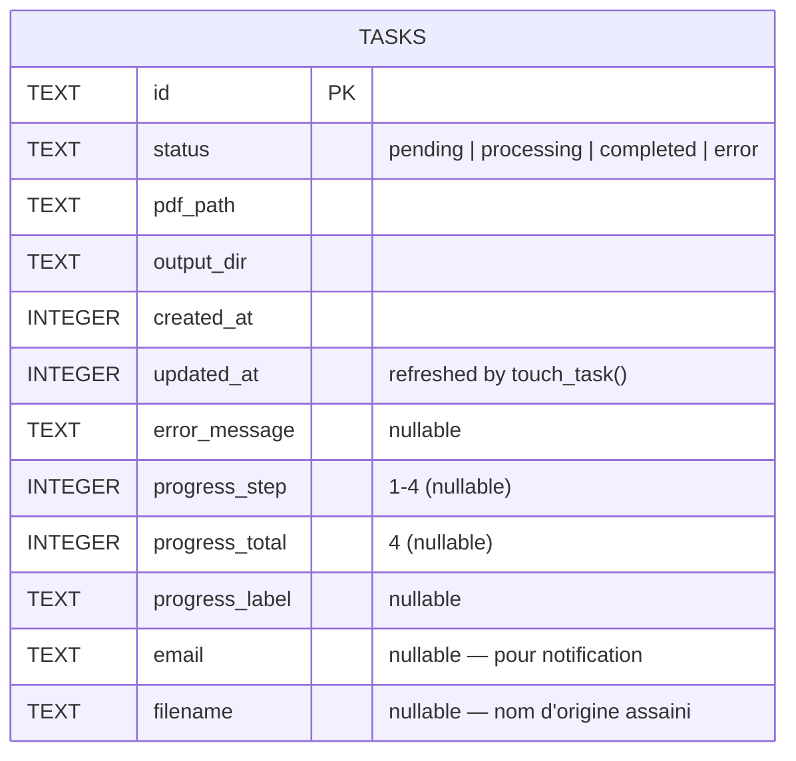
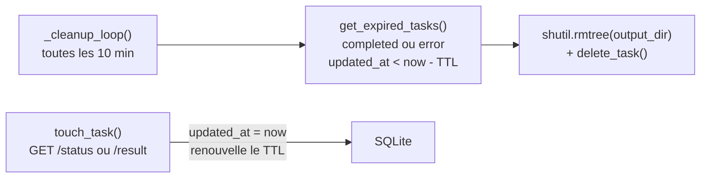

# Architecture générale — Histoolbox

Histoolbox est un monorepo composé de deux applications indépendantes qui communiquent via une API HTTP.

```
histoolbox/
├── frontend/   — React 19 + TypeScript + Tailwind 4 (Vite)
└── backend/    — Python 3.11 + FastAPI + SQLite + Redis/RQ
```

---

## Vue d'ensemble du système



---

## Cycle de vie d'une tâche (State Machine)



**Règle clé :** les tâches `pending` survivent aux redémarrages du serveur API. Seules les tâches `processing` sont marquées `error` au redémarrage (l'inférence ne peut pas reprendre à mi-chemin). Si Redis est également redémarré, `requeue_pending_tasks()` au démarrage du worker ré-enqueue toutes les tâches `pending` trouvées en SQLite.

---

## Frontend

### Principe fondateur : Client-Side First

Les fichiers PDF ne quittent pas le navigateur après upload. Ils sont stockés dans **IndexedDB** (Dexie.js) dès la sélection. Le backend ne reçoit le PDF que le temps du traitement ; les résultats (markdown, blocs) sont rapatriés et persistés localement.

### Système de tools (plug-in/plug-out)

Toute la navigation, les cartes d'accueil et les routes sont générées depuis un **registre central** (`src/tools/registry.ts`). Ajouter un outil = créer un fichier + ajouter une ligne dans le registre.



### Flux OCR — cycle de vie complet



### Recovery au redémarrage

Si l'utilisateur ferme le navigateur pendant un traitement, `OCRRecovery` (composant null-render monté au démarrage) vérifie l'IndexedDB et reprend le polling automatiquement.

### Structure des fichiers frontend

```
src/
├── tools/               ← POINT D'ENTRÉE pour ajouter un tool
│   ├── registry.ts      ← interface ToolDefinition + tableau tools[]
│   └── ocr.tsx          ← tool OCR (routes + OCRRecovery)
│
├── pages/
│   ├── HomePage.tsx         ← grille de cartes (générique)
│   ├── OCRUploadPage.tsx    ← drag & drop + upload + email optionnel
│   ├── OCRWaitingPage.tsx   ← position file + étapes progression
│   ├── OCRToolboxPage.tsx   ← éditeur split-view
│   └── OCRHistoryPage.tsx   ← historique des traitements OCR
│
├── components/
│   ├── AppShell.tsx         ← header + nav (générique)
│   ├── SplitView.tsx        ← panneau divisé draggable
│   ├── PDFPanel.tsx         ← viewer PDF (@react-pdf-viewer)
│   ├── MarkdownEditor.tsx   ← CodeMirror 6 (source / aperçu / blocs)
│   ├── HistoryPage.tsx      ← liste historique générique
│   ├── BlockOverlay.tsx     ← overlay de blocs sur le PDF
│   └── DropZone.tsx         ← drag & drop fichier
│
├── hooks/
│   ├── usePolling.ts        ← polling /ocr/status toutes les 5s
│   └── useAutoSave.ts       ← debounce 1s → IndexedDB
│
├── lib/
│   ├── apiClient.ts         ← fetch wrapper + types partagés
│   ├── blockUtils.ts        ← navigation par blocs
│   └── exportUtils.ts       ← export .md et .docx
│
└── db/
    └── index.ts             ← Dexie.js + OCRProject + CRUD helpers
```

---

## Backend

### Principe fondateur : zéro cold-start

`InferenceManager` (Chandra) est instancié **une seule fois** au chargement du module worker. L'inférence tourne dans le process RQ Worker (synchrone), complètement découplé de la boucle d'événements FastAPI.

### Architecture de la file de tâches



### Structure des fichiers backend

```
backend/
├── run_worker.py              ← entrée RQ : requeue + lance rq.Worker
└── app/
    ├── main.py                ← FastAPI + lifespan + Redis + boucle nettoyage
    ├── database.py            ← SQLite raw (sqlite3 stdlib), zéro ORM
    ├── worker.py              ← process_ocr_job() + requeue_pending_tasks()
    ├── routers/
    │   └── ocr.py             ← endpoints POST/GET + enqueue RQ
    ├── services/
    │   ├── chandra_service.py ← InferenceManager singleton + run_chandra_sync()
    │   └── email_service.py   ← send_notification_email() via smtplib
    └── models/
        └── schemas.py         ← Pydantic : UploadResponse, StatusResponse…
```

### Schéma de la base de données



### Nettoyage automatique (TTL)



- `CLEANUP_TTL_SECONDS` (défaut : `86400`) — conservation d'une tâche terminée sans consultation ; les tâches `pending` et `processing` ne sont jamais supprimées
- `CLEANUP_INTERVAL_SECONDS` (défaut : `600`) — fréquence de la boucle
- Toute lecture (`/status`, `/result`) renouvelle le TTL

---

## Matrice de scénarios

| # | Scénario | Comportement |
|---|---|---|
| S1 | Upload → traitement normal → succès | Job RQ → worker → completed |
| S2 | Fermeture navigateur pendant attente | Recovery polling automatique au retour |
| S3 | Redémarrage API, tâche `pending` | Reste `pending` ; re-enqueuée par `requeue_pending_tasks()` |
| S4 | Redémarrage API, tâche `processing` | Marquée `error` par `init_db()` |
| S5 | Crash Redis, tâche `pending` | Jobs perdus de Redis ; worker restart → `requeue_pending_tasks()` |
| S6 | vLLM coupé en cours de traitement | Timeout CHANDRA_INFERENCE_TIMEOUT → `error` |
| S7 | N PDFs soumis simultanément | N jobs dans la queue RQ, traités 1 par 1 |
| S8 | Email fourni, succès | Email "Transcription terminée" + lien résultat |
| S9 | Email fourni, erreur | Email "Erreur de transcription" + message d'erreur |
| S10 | Email non fourni, navigateur ouvert | Notification OS via Web Notifications API |
| S11 | SMTP non configuré | Log warning, pas d'exception (dégradé gracieux) |
| S12 | Permission navigateur refusée | Silencieux (pas de notification) |

---

## Communication frontend ↔ backend

| Endpoint | Sens | Description |
|---|---|---|
| `POST /ocr/upload` | → | Envoie le PDF + email optionnel, reçoit `task_id` (202) |
| `GET /ocr/status/:id` | → | Interroge statut + position file + progression ; renouvelle le TTL |
| `GET /ocr/result/:id` | → | Récupère markdown + blocs (409 si pas completed) |

Toutes les URLs sont **relatives** côté frontend. Le proxy Vite (`/ocr/*` → `http://localhost:8001`) est actif en développement.

---

## Déploiement

### Local (développement)

Prérequis : Redis accessible sur `localhost:6379`.

```bash
# Terminal 1 : Redis
docker run -d -p 6379:6379 redis:7-alpine

# Tout le reste (API + Worker + Frontend)
./start.sh
```

### Production (docker-compose)

```
backend/docker-compose.yml
├── redis        — Redis 7 Alpine (volume persistant)
├── api          — FastAPI :8001 (dépend de redis)
├── rq_worker    — RQ Worker (même image, CMD run_worker.py)
└── caddy        — Reverse proxy HTTPS (dépend de api)
```

### Variables d'environnement clés

| Variable | Défaut | Description |
|---|---|---|
| `REDIS_URL` | `redis://localhost:6379/0` | Connexion Redis |
| `SMTP_HOST` | `` (vide) | SMTP désactivé si absent |
| `SMTP_PORT` | `587` | Port SMTP (TLS) |
| `SMTP_USER` | `` | Identifiant SMTP |
| `SMTP_PASSWORD` | `` | Mot de passe SMTP |
| `SMTP_FROM` | `` | Adresse expéditeur |
| `APP_BASE_URL` | `http://localhost:5173` | URL de base pour les liens dans les emails |
| `VLLM_BASE_URL` | `http://localhost:8000` | URL du service vLLM |
| `CHANDRA_INFERENCE_TIMEOUT` | `14400` | Timeout inférence (4h) |
| `CLEANUP_TTL_SECONDS` | `86400` | Conservation d'une tâche terminée sans consultation (24 h) |
| `API_KEY` | `` (désactivé) | Clé d'accès partagée |

---

## Décisions techniques

| Décision | Raison |
|---|---|
| RQ + Redis (pas Celery, pas asyncio.Queue) | API simple, worker en 1 commande, survie aux redémarrages, scaling futur |
| `smtplib` stdlib (pas aiosmtplib) | Worker RQ est synchrone, zéro dépendance ajoutée |
| `fakeredis` pour les tests | Intègre le round-trip RQ sans Redis réel en CI |
| `job_id=task_id` dans `queue.enqueue` | Déduplication naturelle lors du requeue |
| `pending` tasks survivent au redémarrage API | Cohérence avec la philosophie "zéro perte de travail" |
| `processing` → `error` au redémarrage | L'inférence ne peut pas reprendre à mi-chemin |
| Web Notifications API (pas Push VAPID) | Couvre le cas "autre onglet" sans HTTPS ni service worker |
| IndexedDB (Dexie.js) pour les PDF | Blob lourd — ne pas le renvoyer au serveur à chaque refresh |
| Polling HTTP (pas WebSocket) | Simple, compatible avec tous les proxies, suffisant pour un TTL long |
| SQLite sans ORM | Zéro dépendance, schéma trivial, performances suffisantes |
