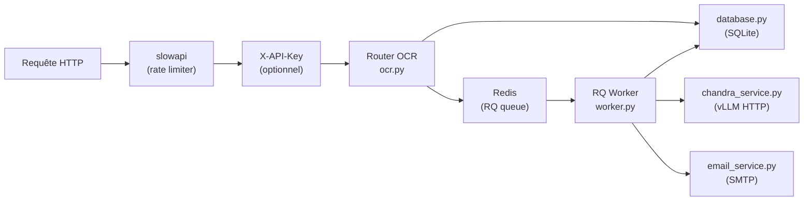
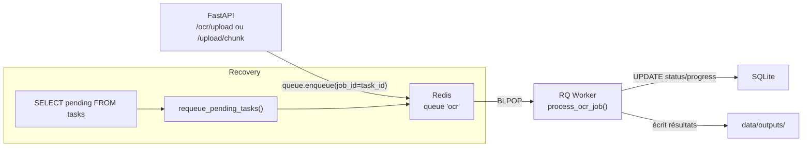
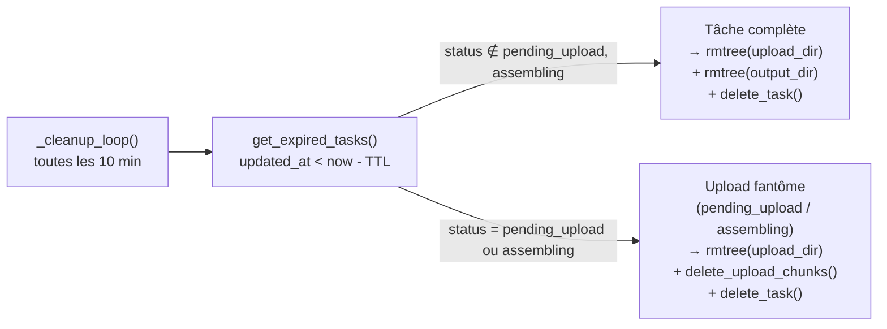

# Architecture backend — Guide développeur

Ce document décrit la structure interne du backend Histoolbox et les conventions à respecter pour le faire évoluer.

---

## Vue d'ensemble

```
backend/
├── main.py                  ← point d'entrée alternatif (symlink → app/main.py)
├── run_worker.py            ← point d'entrée RQ Worker
└── app/
    ├── main.py              ← FastAPI + lifespan + Redis + boucle de nettoyage
    ├── database.py          ← SQLite raw (sqlite3 stdlib), zéro ORM
    ├── limiter.py           ← instance slowapi partagée
    ├── worker.py            ← process_ocr_job() + requeue_pending_tasks()
    ├── routers/
    │   └── ocr.py           ← tous les endpoints /ocr/*
    ├── services/
    │   ├── chandra_service.py ← InferenceManager singleton + run_chandra_sync()
    │   └── email_service.py   ← send_notification_email() via smtplib
    └── models/
        └── schemas.py       ← Pydantic : toutes les réponses typées
```

---

## Flux d'une requête



---

## Couche HTTP — `app/routers/ocr.py`

Tous les endpoints vivent dans un seul router monté sous le préfixe `/ocr`.

| Endpoint | Méthode | Description |
|---|---|---|
| `/upload` | POST | Upload monolithique (CLI) — reçoit le PDF complet |
| `/upload/chunk` | POST | Upload par chunk 5 Mo (web) — assemblage atomique au dernier chunk |
| `/upload/chunks/{id}` | GET | Liste des index de chunks déjà reçus (reprise d'upload) |
| `/status/{id}` | GET | Statut + position file + progression Chandra |
| `/result/{id}` | GET | Résultat complet : markdown + blocs + métadonnées |

### Invariants de sécurité

- **Rate limiting** : `10/minute` sur `/upload` et `/upload/chunk`, via `slowapi`.
- **Validation MIME** : seul `application/pdf` et `application/octet-stream` sont acceptés sur `/upload`.
- **Validation email** : présence du `@` vérifiée si le champ est fourni.
- **Validation chunk_index** : rejet 422 si hors plage `[0, total_chunks - 1]`.

---

## Couche base de données — `app/database.py`

SQLite pur, sans ORM, sans migration framework. Le schéma est créé/mis à jour par `init_db()` au démarrage.

### Tables

```sql
tasks (
    id              TEXT PRIMARY KEY,
    status          TEXT NOT NULL,   -- voir machine d'états ci-dessous
    pdf_path        TEXT NOT NULL,
    output_dir      TEXT NOT NULL,
    created_at      INTEGER NOT NULL,
    updated_at      INTEGER NOT NULL,  -- sert de TTL (rafraîchi par touch_task)
    error_message   TEXT,
    progress_step   INTEGER,
    progress_total  INTEGER,
    progress_label  TEXT,
    email           TEXT
)

upload_chunks (
    task_id     TEXT    NOT NULL,   -- FK implicite vers tasks.id
    chunk_index INTEGER NOT NULL,
    PRIMARY KEY (task_id, chunk_index)
)
```

### Statuts de `tasks.status`

```
pending_upload  → assembling  → pending  → processing  → completed
                                                       ↘  error
```

- **`pending_upload`** — upload par chunks en cours, fichier incomplet
- **`assembling`** — dernier chunk reçu, assemblage du PDF en cours (transitoire)
- **`pending`** — PDF complet, job enqueued dans Redis
- **`processing`** — worker RQ en cours d'inférence
- **`completed`** — inférence terminée avec succès
- **`error`** — échec (inférence, timeout, crash, upload abandonné)

`init_db()` réinitialise `processing`, `assembling` et `pending_upload` → `error` au redémarrage.

### Helpers clés

| Fonction | Description |
|---|---|
| `create_task()` | Crée une tâche `pending` (upload monolithique) |
| `create_task_pending_upload()` | Crée une tâche `pending_upload` (chunk 0) |
| `try_finalize_assembly(task_id, chunk_index, total)` | Atomique — retourne `True` si cet appelant doit assembler |
| `register_chunk()` | `INSERT OR IGNORE` — idempotent |
| `get_received_chunk_indexes()` | Liste triée des index reçus |
| `touch_task()` | Rafraîchit `updated_at` (renouvelle le TTL) |
| `get_expired_tasks(cutoff)` | Tâches dont `updated_at < cutoff` |

### Atomicité de l'assemblage

`try_finalize_assembly()` utilise `BEGIN IMMEDIATE` (verrou exclusif SQLite) + un CAS sur le statut :

```sql
-- Dans une transaction BEGIN IMMEDIATE :
INSERT OR IGNORE INTO upload_chunks (task_id, chunk_index) VALUES (?, ?);
SELECT COUNT(*) FROM upload_chunks WHERE task_id = ?;
-- Si count == total_chunks :
UPDATE tasks SET status='assembling' WHERE id=? AND status='pending_upload';
-- rowcount == 1 → cet appelant est le gagnant
```

Cela garantit l'unicité de l'assemblage même si FastAPI traite plusieurs requêtes de chunks simultanément (workers Uvicorn ou envois parallèles).

---

## File de tâches — RQ + Redis



- `job_id=task_id` : déduplication naturelle — ré-enqueuer une tâche déjà dans la queue est sans effet.
- `job_timeout = CHANDRA_INFERENCE_TIMEOUT + 300` : marge de 5 min au-delà du timeout Chandra.
- `requeue_pending_tasks()` est appelé au démarrage du worker (`run_worker.py`).

---

## Worker — `app/worker.py`

`process_ocr_job()` est la fonction exécutée dans le process RQ (synchrone, pas async).

```
process_ocr_job(task_id, pdf_path, output_dir, email?)
    ├── update_task_status(processing)
    ├── update_task_progress(1/4, "Chargement du PDF")
    ├── run_chandra_sync(pdf_path, output_dir)   ← appel vLLM HTTP
    │       └── InferenceManager.load_file() + .generate()
    ├── update_task_status(completed)
    └── send_notification_email()  ← si email fourni et SMTP configuré
```

En cas d'exception : `update_task_error(message)` + email d'erreur si fourni.

---

## Service Chandra — `app/services/chandra_service.py`

`InferenceManager` est instancié **une seule fois** au chargement du module (zéro cold-start).  
`run_chandra_sync()` est appelé depuis `asyncio.to_thread()` pour ne pas bloquer la boucle d'événements FastAPI pendant les pre-flight checks.

Variables d'environnement :

| Variable | Défaut | Description |
|---|---|---|
| `VLLM_BASE_URL` | `http://localhost:8000` | URL du service vLLM |
| `CHANDRA_INFERENCE_TIMEOUT` | `14400` | Timeout inférence (4h) en secondes |

---

## Service Email — `app/services/email_service.py`

`send_notification_email()` utilise `smtplib` (stdlib, synchrone — compatible avec le worker RQ).  
Si `SMTP_HOST` est vide, la fonction log un warning et retourne silencieusement (dégradé gracieux).

---

## Nettoyage automatique (TTL)

`_cleanup_loop()` tourne en arrière-plan dans `main.py` (tâche asyncio).



Le TTL est **renouvelé** à chaque appel à `GET /status` ou `GET /result` via `touch_task()`.

---

## Authentification

Si `API_KEY` est défini (variable d'environnement), toutes les requêtes doivent porter le header `X-API-Key`. En développement local (`API_KEY` vide), la vérification est ignorée.

---

## Tests

```
tests/
├── conftest.py          ← fixtures : DummyQueue, DB SQLite temporaire, client ASGI
├── test_ocr.py          ← endpoints (upload, chunk, status, result, GC, atomicité)
├── test_database.py     ← CRUD SQLite, TTL, queue position
├── test_chandra_service.py ← pre-flight, timeout, retry
├── test_email_service.py   ← envoi, SMTP absent, template
└── test_worker.py       ← process_ocr_job, requeue, error path
```

### Conventions

- **DB isolée par test** : `HISTOOLBOX_DB_PATH` pointe vers un fichier temporaire ; `clean_db` fixture recrée les tables et vide `tasks` + `upload_chunks` entre chaque test.
- **Redis mocké** : `DummyQueue` (dans `conftest.py`) enregistre les appels à `enqueue()` sans Redis réel.
- **Chandra mocké** : `unittest.mock.patch` sur `run_chandra_sync` pour éviter les appels vLLM.
- Lancer : `uv run pytest tests/ -v`

---

## Ajouter un nouvel endpoint

1. Déclarer le schéma Pydantic dans `models/schemas.py`.
2. Ajouter la fonction dans `routers/ocr.py` (ou créer un nouveau router si le périmètre est distinct).
3. Monter le router dans `app/main.py` si nouveau.
4. Écrire les tests dans `tests/test_ocr.py`.

**Ne pas modifier `database.py` sans ajouter une migration additive** dans `init_db()` (`ALTER TABLE ... ADD COLUMN IF NOT EXISTS` via `try/except`).
